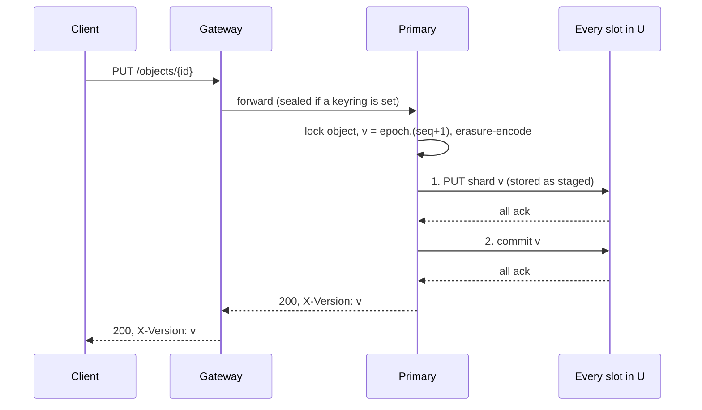

# Simplified RADOS style system design


## Components

An object store. An object id hashes to one of `pg_num` placement groups (PGs). Each PG stores every object as `n = k+m` erasure-coded shards, one per node (`k=1` is plain replication).

- **gateway**: stateless. Hashes the id, forwards to the PG's primary, refetches the map on error.
- **monitor**: owns the `map` and node states. One instance first, Raft later.
- **node**: every node is a `holder` (stores shards). It is also the `primary` of the PGs where the map names it so. The primary serializes operations per object.


## Config and map

Config is fixed at bootstrap: `k`, `m`, `pg_num`, `min_size` (`k` ≤ `min_size` ≤ `n`, default `k+1`), `bootstrap_nodes` (≥ `n`), `lease`, `grace` (≥ 2×`lease`), `max_object`.

```
map = { epoch, params,
        nodes: { node_id: { addr, state: up|out } },
        pgs:   [ [ { node, backfilling } x n ] ] }        # index = pg id, index in list = slot
```

Everyone derives the rest from the map:

- `pg(id)` = first 8 bytes of `sha256(id)` mod `pg_num`.
- `U` = slots whose node is `up`. `B` = `U` minus `backfilling` slots.
- `primary` = lowest slot in `B`. The PG is serviceable only if `|B| >= min_size`.
- Version = `(epoch, seq)`, compared numerically. Written `epoch.seq`.

Shard record at a holder: `{id, version, size, sha256, data}`, or a tombstone `{id, version, deleted}`. A version is `staged` or `committed`. An object is **dirty** if it holds any staged version. Writes are durable (fsync) before they are acknowledged. Each PG also stores a durable `fence` (an epoch).


## Routes

| From -> to | Route | Notes |
| --- | --- | --- |
| Gateway -> Monitor | `GET /map` |  |
| Node -> Monitor | `GET /map` |  |
| Node -> Monitor | `POST /node/heartbeat` `{node_id, boot_id}` | Reply `{epoch, state}`, `state` is `up` or `out`. 404 if unknown. Also used at boot |
| Node -> Monitor | `POST /node/join` `{node_id, boot_id, addr}` | New node, or an `out` node after purging. Same reply |
| Node -> Monitor | `POST /pg/{pg_id}/backfill_done?slot=i` `{epoch, node_id}` | Sent by the primary. Clears the slot's `backfilling` flag |
| Monitor <-> Monitor | `POST /raft/vote`, `POST /raft/append` | Only after the Raft phase |
| Gateway -> Primary | `GET`, `PUT`, `DELETE /objects/{id}` | No request ID. Whole object, ≤ `max_object`. `421` not primary, `503` PG inactive: refetch the map and retry. Reply carries the version |
| Primary -> Holder | `PUT /pg/{pg}/shards/{id}/{version}` | Stored `staged`, beside older versions |
| Primary -> Holder | `GET /pg/{pg}/shards/{id}[/{version}]` | Latest committed if the version is omitted. Staged versions are only served when named |
| Primary -> Holder | `POST /pg/{pg}/commit` | Batch `[{id, version}]`. Promotes the version and deletes older ones. Idempotent |
| Primary -> Holder | `POST /pg/{pg}/discard` | Batch `[{id, version}]`. Deletes that version whatever its state. Idempotent |
| Primary -> Holder | `POST /pg/{pg}/scan` | Peering step 1. Raises the fence. Returns `[{id, versions}]` for dirty objects |
| Primary -> Holder | `POST /pg/{pg}/lookup` | Peering step 2. Ids in, `[{id, versions}]` held out (staged or committed) |

Every Primary -> Holder request carries `epoch`. The holder answers `409 {fence}` if `epoch < fence`. The sender then drops its primary role and refetches the map.


## Flows

**Node boot.** Heartbeat. On `404` or `out`: purge all local PG data, then `join`. If the reply epoch differs from the local map: `GET /map`. Heartbeats repeat every `lease/4`.

**Serve gate.** A node serves (primary or holder) only while its last successful heartbeat was sent less than `lease` ago, said `up`, and its map epoch equals the reply epoch. This stops a partitioned or stale node.

**Monitor.** The map is persisted (fsync) before any reply that depends on it, so `epoch` survives a restart. On start, every node counts as just heard from, so a restart does not mark nodes `out`. Every change below bumps `epoch`.
1. `join`: node becomes `up` (409 if already `up`). Once `bootstrap_nodes` are up, the PG table is created once: slot `i` of pg `p` is the node at index `(p+i) mod N` of the sorted node ids. Later joiners are spares. There is no rebalancing.
2. No heartbeat for `grace`: node becomes `out`. All its slots get `backfilling=true`.
3. Heartbeat from an `up` node with a new `boot_id`: record it. The bump re-peers its PGs and keeps versions unique.
4. A slot whose node is `out` is given to the `up` node not already in that PG that holds the fewest slots (ties: lowest id), still `backfilling`. With no candidate it stays vacant.
5. `backfill_done`: accepted only if `epoch` is current and the slot's node is `node_id`. Clears the flag.

**Peering.** Runs on the primary whenever the map epoch changes, or after any failed operation. The PG is inactive meanwhile and answers `503`.
1. `scan` every slot in `U`, including itself. This fences them at `epoch`. All must answer, otherwise retry until the map changes. The dirty ids are the union.
2. `lookup` the dirty ids on `B`. Per id, the **winner** is the highest version held by ≥ `k` slots of `B`. It may be none.
3. With a winner `w`: `commit w` where held. Re-encode and `PUT` + `commit` the shard on `B` slots lacking it (a tombstone needs no decoding). `discard` every version above `w`. Without a winner: `discard` every version seen.
4. The PG is active. `seq` resumes from its previous value (kept in memory), starting at 0 in a new epoch.

**Write and delete.** A delete is a write of a tombstone, and committing a tombstone removes the object entirely. Take the object lock and `v = (epoch, ++seq)`.
1. Encode, then `PUT` the shard to every slot in `U` (backfilling ones too). All must ack.
2. `commit` to every slot in `U`. All must ack.
3. Reply with `v`.

Any failure: reply `503`, send a best-effort `discard`, and re-peer. A delete is idempotent: it always succeeds once committed.



**Read.** Take the object lock. `GET` the latest committed shard from `B` slots (itself first) until `k` agree on one version. All-absent gives `404`. A disagreement, a checksum failure or fewer than `k` answers gives `503`, then re-peer. The `sha256` is verified on every shard write and read.

**Backfill.** The primary runs this for each `backfilling` slot in `U`. The target is empty, because a node always purges before it holds a slot. For each local object, under its lock: skip it if the target already holds that version (`lookup`), otherwise decode and `PUT` + `commit` the shard. Then send `backfill_done`. If it is rejected as stale, re-peer and resend. Concurrent writes already reach the target, because it is in `U`.


## Invariants

1. A write is acknowledged only when committed on every slot in `U`, so every node in `B` holds every acknowledged write. This is why `min_size ≥ k` is enough for peering to find it.
2. A node joins `B` only through `backfill_done`, after it has received everything. A node that has missed a write is never read from or counted.
3. Peering fences all of `U` before the new primary acts. A deposed primary then needs an ack from a fenced holder, so it cannot complete a write.
4. Versions are unique. Any primary restart or change bumps `epoch`, so no two writes share `(epoch, seq)`.
5. `epoch` only increases. The map changes only at the monitor, and is persisted before use.

**Timing assumption.** Write safety needs no clocks. Read freshness relies on the serve gate: a deposed primary stops serving before the monitor reassigns its role (`grace ≥ 2×lease`, clocks of similar rate). While the monitor is down, nodes stop serving after `lease`. Raft removes this.


## Non-goals

Auth/TLS. Key rotation (rewrapping existing objects). Rebalancing when nodes are added. Partial or range I/O. Request IDs: a timed-out request has an unknown outcome, and retries are at-least-once, last-writer-wins. Delta recovery: any node out longer than `grace` is fully re-backfilled. Scrubbing and bitrot repair: a bad checksum just makes the shard unavailable.


